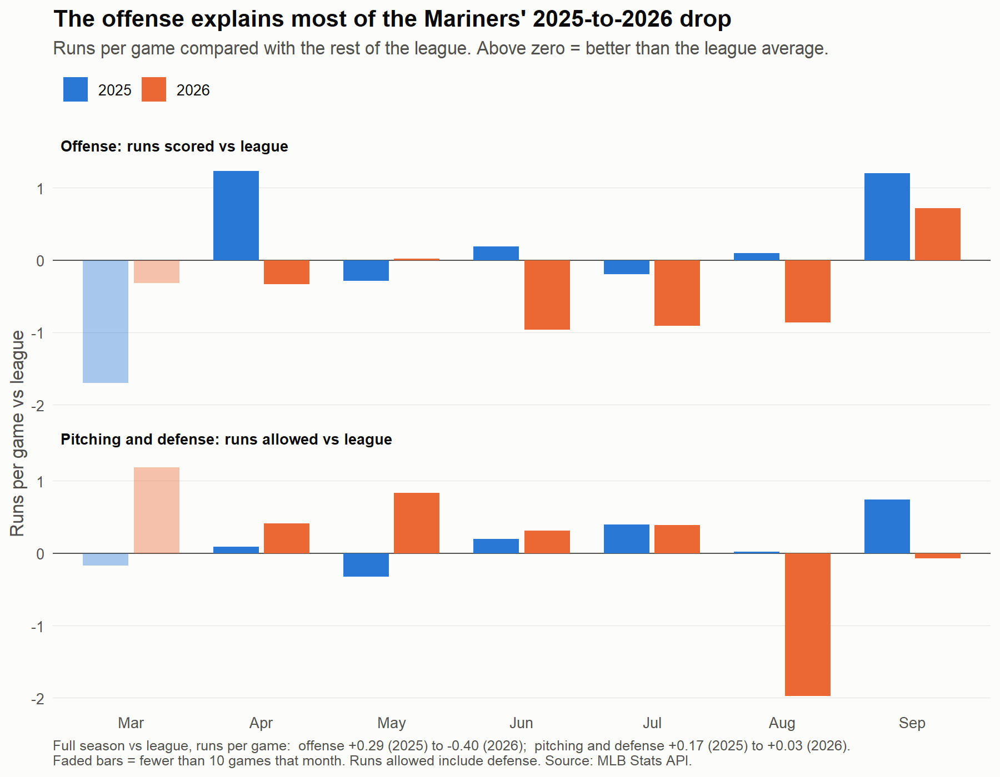
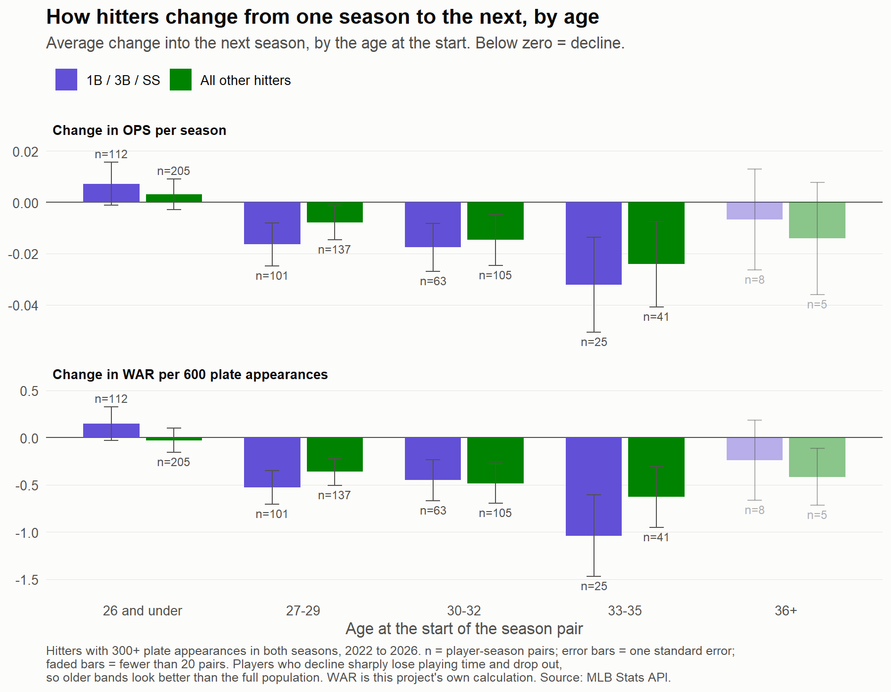

# Seattle Mariners Stretch-Run Analyzer

A Python pipeline that pulls live 2026 MLB data — batting, pitching, standings, Statcast, and minor-league affiliate stats — from MLB's official sources and turns it into player grades, roster decisions, rest-of-season projections, and free-agent/prospect recommendations, all validated against real professional benchmarks. The data also goes into a MySQL database, and R is used for the multi-season analysis (aging curves, offense vs. pitching).

## Project description

**Data**: 2026 season — standings, schedules, rosters, batting, pitching, fielding and minor-league stats from the official MLB Stats API, plus Statcast from Baseball Savant. Payroll, free-agent market prices and prospect rankings come from small CSV files you maintain, and ABS challenge data from Baseball Savant leaderboard downloads (see [Data sources](#data-sources)). WAR is the project's own calculation (see `mlb_api.py`).

**Core pipeline** (`python main.py`):
- Gets live standings across all 30 MLB teams
- Gets the Mariners' full season schedule (completed games + upcoming)
- Gets batting stats and advanced Statcast metrics, league-wide
- Gets pitching stats and advanced Statcast metrics, league-wide
- Gets the Mariners' own batting, pitching, fielding, and Statcast data specifically
- Grades every Mariners player and drives roster decisions — keep, DFA, option to AAA, monitor — based on real performance, not gut feel
- Grades batters on OPS, xwOBA, and luck (xwOBA vs. actual production gap); grades pitchers on ERA, WHIP, K/9, xwOBA against, and luck
- Runs a rest-of-season simulation (live record, run differential, luck correction, real schedule difficulty, IL-return timelines) to project the final record and playoff odds
- Runs a standalone Monte Carlo simulation (thousands of simulated seasons + postseason brackets) for a higher-resolution playoff-odds estimate

**Additional tools** (run separately from the core pipeline):
- **Offseason report and weakness targets** (`offseason_report.py`, `weakness_targets.py`, `story_app.py`) — ranks the team's weakest positions and stats against the league, scores candidates by fit (position, handedness, need), and presents it as a Streamlit app, with an age-risk column for each hitter taken from the R aging curves
- **Free-agent recommendations** (`free_agent.py`, `free_agent_stats_matcher.py`, `free_agent_recs.py`, `mlb_free_agents.py`) — loads the free-agent class (your list, or MLB's own free-agent list), matches players to league-wide stats, and scores every free agent *and* internal roster candidate against the Mariners' actual incumbent at each position, weighted by need and reliability (sample-size shrinkage)
- **Minor-league prospect tracking** (`minor_league_stats.py`, `minor_league_shortlist.py`) — pulls the full organizational batting/pitching stats (MLB Stats API) and your top-prospect rankings CSV, filtered down to real, near-MLB-ready talent (AA/AAA, meaningful sample size, excluding anyone already on the active roster)
- **Injury cost tracking** (`injury_cost_track.py`) — role-aware estimate of real wins lost to injury, weighted by leverage for relievers and games-missed for everyday players
- **Payroll tracking** (`payroll.py`) — team and league-wide payroll comparisons from your payroll CSVs
- **Platoon lineup optimizer** (`platoon_lineup_optimizer.py`) — vs-LHP/vs-RHP lineup construction from real split data
- **Starting-pitcher and ABS studies** — pitch counts, velocity, pitch mix, whiffs, release point and ABS challenges; see [Starting-pitcher studies](#starting-pitcher-studies-2025-vs-2026-and-abs)
- **MySQL database and SQL queries** (`load_mysql.py`, `sql/`) — loads the cached games, pitches, plate appearances and player stats into MySQL and answers questions with SQL, including whether offense or pitching explains the 2025-to-2026 drop; see [MySQL database](#mysql-database-and-sql-queries)
- **R analysis** (`r/offense_vs_pitching.R`, `r/aging_curves.R`) — reads the MySQL database and draws charts: where the 2025-to-2026 drop came from, and how much hitters at 1B, 3B and SS decline with age. The aging results feed the app's age-risk column; see [R analysis](#r-analysis-aging-curves-and-offense-vs-pitching)

## What makes it different

- **Built on official, permitted sources.** The MLB Stats API for traditional stats, standings, rosters and minor leagues; Baseball Savant for Statcast (xwOBA, Barrel%, Whiff%, Outs Above Average). One shared module (`mlb_api.py`) handles every API call, caching, and the project's own WAR, so every table uses the same player IDs and league context.
- **Recommendations come from real statistical need, not a fixed wishlist.** Both the free-agent tool and the (now-dated, see note below) in-season trade-target logic identify the team's actual weak spots by position and stat, league-wide, rather than starting from a hand-picked list.
- **Validated against real, independent models, not just self-consistent.** Simulator output was sanity-checked against publicly published playoff-odds projections. That process surfaced and fixed a real bug that had been silently excluding a chunk of the remaining schedule from every projection — the tool catching its own mistakes rather than just producing a number and trusting it. The same discipline (a small debug script to confirm the real data structure before trusting a source) has been used to catch and fix real bugs throughout this project.

> **Note on trade targets:** `recommender.py`'s seller-based trade-target logic and the simulator's "deadline simulation" step were built for the in-season trade deadline. That's now passed for 2026 — the code still runs, but the free-agent/internal-candidate pipeline is the more current answer to "how does this team improve." Worth deciding whether to keep, retire, or repurpose the deadline-era code for next year's stretch run.

## Steps (core pipeline)

```
STEP 1/6 -- Building data...
STEP 2/6 -- Analyzing team...
STEP 3/6 -- Grading players...
STEP 4/6 -- Generating recommendations...

[recommend] Generating recommendations...
  [targets] filtering batters to positions the team actually needs: [...]
  [targets] N teams flagged as likely sellers based on live standings
  [targets] N batter targets found
  [targets] N pitcher targets found
[recommend] Done.

STEP 5/6 -- Running rest-of-season simulation...
STEP 6/6 -- Generating Excel report...
```

Run it with:
```
python main.py --refresh
```

Output is a formatted Excel report (Team Summary, Player Grades, Statcast, Stats to Improve, Trade Targets, Schedule, Simulation) plus an appended row in `data/history.parquet` for tracking trends over time in Power BI.

For a standalone, higher-resolution playoff-odds estimate:
```
python montecarlo.py --sims 5000
```

For free-agent and internal roster recommendations:
```
python free_agent_recs.py
```

For real, near-MLB-ready minor-league talent (excludes anyone already on the active roster):
```
python minor_league_shortlist.py
```

## Offseason workflow

```
python main.py --refresh --print-only    # refresh data and grades without writing the Excel report
python offseason_report.py               # where the team is weakest, by position and stat
python weakness_targets.py               # candidates ranked by fit to those weaknesses
python -m streamlit run story_app.py     # the same, as an app
python mlb_free_agents.py                # after the World Series: fills data/inputs/free_agents.csv
```

The free-agent list only exists after the World Series. Market prices in `data/inputs/free_agent_market.csv` are entered by hand.

## Starting-pitcher studies (2025 vs 2026) and ABS

A set of small, self-contained studies built on MLB's public Stats API play-by-play and Baseball Savant's
manual leaderboard downloads. They answer: *when should a Mariners starter come out, and why did some
starters slip from 2025 to 2026?*

**Data and limits.** Play-by-play comes from `statsapi.mlb.com` (one request per game, cached on disk,
with a pause between requests and a descriptive user-agent). ABS leaderboards are downloaded by hand from
Baseball Savant. Samples are small (17-32 starts per pitcher), numbers are raw (no park, opponent or
defense adjustment), and everything below is a pattern worth watching, not proof of cause.

| Script | What it does |
|---|---|
| `pitch_count_study.py` | Opponent OPS by pitch count, inning and times through the order; fastball velocity by start. Caches every game. |
| `compare_seasons.py` | Every starter, 2025 -> 2026: workload, results, velocity, innings, times through the order. |
| `pitchmix_babip.py` | Pitch mix by pitch type, and BABIP / hard-hit rate against. |
| `whiff_by_pitch.py` | Whiff, called+swinging strike, zone and chase rates per pitch type. |
| `pitchshape.py` | Spin, movement, extension, release and location per pitch type; lists pitches that lost whiffs and what changed with them. |
| `release_timeline.py` | Release point by start; dates the biggest shift and says whether it fell at a season boundary. |
| `abs_analysis.py` | ABS challenge results for Mariners hitters, catchers and teams from the Savant downloads. |

```
python pitch_count_study.py          # first run downloads the season (about 1-2 minutes), then it is cached
python compare_seasons.py            # 2025 vs 2026 (add --a/--b for other years)
python pitchmix_babip.py
python whiff_by_pitch.py
python pitchshape.py
python release_timeline.py
python abs_analysis.py               # needs the Savant CSVs in data/inputs
```

### What they found

- **Pitch count is not the signal.** Opponent OPS does not climb through about 100 pitches, and starters rarely
  go past it. The weak spots are the 6th inning and the third time through the order (OPS against .695 / .701 / .751
  the first, second and third time). Castillo is the exception: his trouble comes early (pitches 26-50, innings 3-4).
- **Velocity is not a "take him out" signal either.** Starts 1+ mph below a pitcher's own median allowed 2.91 runs per
  27 batters, against 3.01 in normal starts, and 54 of 138 starts lose 1+ mph from the first to the last 25 pitches
  with nothing wrong (Kirby and Gilbert do it almost every start).
- **The staff barely slipped; four starters did.** Staff OPS against went from .700 to .710 and runs per 27 batters from
  2.86 to 2.93, with hard contact down 3.4 points. Kirby, Woo, Castillo and Gilbert lost strikeouts (Kirby's whiff rate
  26.7% -> 22.4%) while Hancock and Miller, who rebuilt their pitch mix, improved.
- **Where it went wrong.** Castillo's slider lost 11 points of whiff rate (36.5% -> 25.5%) and is thrown in the zone far more
  often (38.8% -> 51.4%). Woo's 2025 BABIP (.239) was unusually low and moved to .285. Gilbert threw fewer of his best
  strikeout pitches while his release point drifted about 9 inches over the season. Release-point shifts happened on
  different dates for different pitchers, so they are not a tracking recalibration.
- **ABS.** Challenges cost the Mariners roughly a quarter of a win, partly through challenges not taken
  (runs taken 24.3% vs 28.3% for the league) rather than bad challenges.

### Caveats

Starters are pulled when they tire (selection bias), runs include unearned runs, and several pitch-level comparisons rest on
a modest number of swings. Treat each result as a lead to check with more data.

`data/` is git-ignored: the scripts rebuild their cache, and Savant CSVs are downloaded by hand.

## MySQL database and SQL queries

The cached data can be loaded into a local MySQL database, so questions about the team can be answered
with SQL instead of pandas code.

```
pip install sqlalchemy pymysql
python load_mysql.py          # asks for your MySQL password; creates the mlb_project database
```

For the multi-season analysis, build and load the earlier seasons' player tables too:

```
python build_history.py                                       # player tables for 2022-2025, cached as parquet
python load_mysql.py --players-only 2022 2023 2024 2025 2026  # loads them into MySQL
```

The loader reads the files the other scripts already cache (`data/exports`, `data/cache`, the Statcast CSVs)
and the season schedule, creates the tables from `sql/schema.sql`, and fills them. Re-running it replaces a
season's rows instead of duplicating them. Connection settings come from the environment
(`MLB_DB_HOST`, `MLB_DB_PORT`, `MLB_DB_USER`, `MLB_DB_PASSWORD`, `MLB_DB_NAME`); the password is never stored in the
repo. Tested on MySQL 8 and MariaDB.

| Table | Contents |
|---|---|
| `games` | Every regular-season game: date, teams, runs, innings, whether it was played |
| `plate_appearances` | Every plate appearance against Mariners pitchers: pitcher, batter, times through the order, result |
| `pitches` | Pitch-by-pitch: type, speed, spin, movement, release point, location, call |
| `batting_players`, `pitching_players` | League-wide season stats by player, 2022 to 2026 |
| `batting_seasons` (view) | One row per hitter per season: age, position, PA, HR, OPS, WAR |
| `statcast_players` | xwOBA, Barrel%, hard-hit and whiff rates by player |

`sql/queries.sql` holds the analysis queries: runs scored and allowed by month against the league, starter
workload and fastball velocity, OPS against by time through the order, whiff rate by pitch type, hitters'
expected stats, and the Mariners' league ranks.

### What the first query found

Does the offense or the pitching explain the 2025-to-2026 drop? Measured per game against the rest of the league:

| | Offense vs. league | Pitching and defense vs. league |
|---|---|---|
| 2025 | +0.29 runs | +0.17 runs |
| 2026 | -0.40 runs | +0.03 runs |
| Change | **-0.69** | -0.14 |

- **The offense explains about 83% of the drop.** It went from above the league average to clearly below it and
  was below the league in five of seven months of 2026; pitching and defense stayed near average.
- **The one big pitching problem was a single month.** Runs allowed jumped to 6.26 per game in August 2026
  (1.97 runs per game worse than the league), while pitching beat the league in every month before it.
- **Caveats.** The first and last months hold few games, "pitching" here means runs allowed and so includes
  defense, and this is one season compared with another, a pattern rather than proof.

## R analysis: aging curves and offense vs pitching

Two R scripts read the MySQL database (DBI and RMariaDB), do the calculation in R and draw the chart with ggplot2.
The MySQL password is asked for when the script runs and is never stored in the repo.

```r
# in RStudio, from the project folder
setwd("C:/path/to/MLB-Project")
source("r/offense_vs_pitching.R")   # Mariners vs the league by month, 2025 vs 2026
source("r/aging_curves.R")          # how hitters change from one season to the next, by age
```

Packages: `install.packages(c("DBI", "RMariaDB", "dplyr", "ggplot2", "rstudioapi"))`.



The same finding as the SQL query above, drawn month by month: the offense moved much more than the pitching.

### Aging curves for 1B, 3B and SS

How much does a hitter change from one season to the next, by age? The script takes every hitter with 300+ plate
appearances in two consecutive seasons (802 player-season pairs, 2022 to 2026), measures the change in OPS and in WAR
per 600 plate appearances, and averages it by the age at the start of the pair. Players with more plate appearances
count more. The Mariners' positions of need (1B, 3B, SS) are compared with all other hitters.



- **Hitters decline steadily from the late 20s.** At ages 27 to 32 a hitter typically loses about half a win per 600
  plate appearances each season (1B/3B/SS: -0.53 at 27-29 and -0.45 at 30-32; other hitters: -0.36 and -0.48).
- **Infielders may age a little harder, but the data cannot show it yet.** At 33-35 they lost 1.04 WAR per 600 PA against
  0.63 for other hitters (25 and 41 players), but the error bars overlap. With five seasons of data this is a hint,
  not a finding.
- **Ages 36 and up are too thin to use** (8 infielders, 5 other hitters); the chart fades any band under 20 pairs.
- **Caveat.** Players who decline sharply lose playing time and drop out of the sample, so the real decline is probably
  steeper than shown. WAR is this project's own calculation.

The script also saves `data/exports/aging_by_age_band.csv`. `age_risk.py` reads it and adds an **age risk** column to
the free-agent screens of the app: the typical decline for a hitter of that age and position group, labelled Low,
Moderate or High (or "Too few to say" for thin bands). It is an average for players like him, not a forecast for one
player, and it covers hitters only.

## Future opportunities

- Fold minor-league shortlist candidates into the free-agent recommendation scoring, so "sign a free agent," "promote a prospect," and "play the bench guy we already have" are one ranked list instead of three separate tools
- Compare against previous seasons (multi-year player and team trend analysis; the starting-pitcher studies already do this for pitching)
- Backtest the rest-of-season projection system against the actual final outcome once the season ends
- Extend payroll data (`payroll.py`) into genuine value-per-dollar analysis
- Model in R: replacement level by position, and a back-test of the free-agent fit model against past offseasons (aging curves are done, see above)
- Load earlier seasons' Statcast tables into MySQL (player batting and pitching stats for 2022 to 2026 are already there)
- Decide the fate of the trade-deadline-specific code (see note above) before next season's stretch run

## Data sources

| What | Source | File |
|---|---|---|
| Standings, schedules, rosters, player/team stats, minor leagues, platoon splits | [MLB Stats API](https://statsapi.mlb.com) via `MLB-StatsAPI` | `mlb_api.py` and the modules built on it |
| Pitch-by-pitch play-by-play (pitch counts, velocity, spin, release, results) | [MLB Stats API](https://statsapi.mlb.com), cached per game | `pitch_count_study.py` and the studies built on it |
| Statcast (xwOBA, Barrel%, Whiff%), fielding runs (Outs Above Average) | [Baseball Savant](https://baseballsavant.mlb.com) | `statcast_scraper.py`, `mlb_api.py`, `team_half_splits.py` |
| Free agent class | Your list, or MLB's free-agent list | `data/inputs/free_agents.csv` |
| Free agent prices (last salary, contract type) | Your list | `data/inputs/free_agent_market.csv` |
| Payroll | Your list | `data/inputs/payroll_players.csv`, `data/inputs/payroll_league.csv` |
| Top prospect rankings | Your list | `data/inputs/top_prospects.csv` |
| ABS challenges | Baseball Savant ABS leaderboard, "Download CSV" by hand (batter, catcher, batting-team and fielding-team views) | `data/inputs/abs*.csv`, read by `abs_analysis.py` |

Blank CSV templates with the right column headers are created in `data/inputs/` the first time each feature runs; anything left empty is skipped gracefully. Data is not included in this repository (`data/` is git-ignored) — run `python main.py --refresh` to build it locally.

MLB data © MLB Advanced Media, L.P. Use is personal and non-commercial, per MLB's [copyright notice](http://gdx.mlb.com/components/copyright.txt).

### About WAR

WAR here is calculated by this project (`mlb_api.py`), not taken from another site, so numbers will be close to but not identical to other published WAR figures:

- **Batters:** (batting runs from wOBA + baserunning runs + Statcast fielding runs + positional adjustment + replacement runs) ÷ runs per win
- **Pitchers:** runs allowed per 9 vs. a league baseline adjusted for role (starter/reliever) and the team's defense, compared to a replacement-level pitcher; relievers are scaled by an estimated leverage

**Fielding column names.** `Rtot` and `Rdrs` in the code are older column names. In this project both hold Statcast fielding runs (Outs Above Average, plus framing runs for catchers), not figures from another site.
