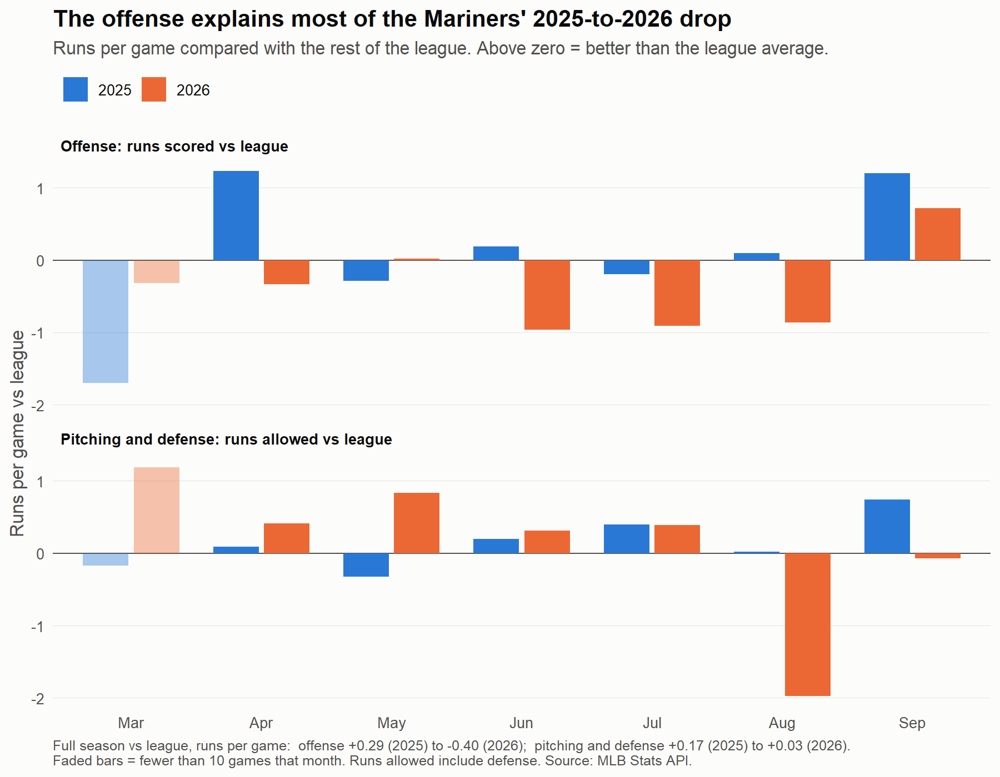
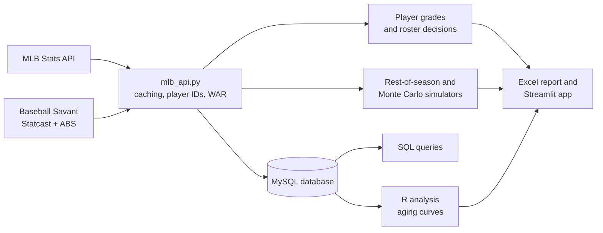
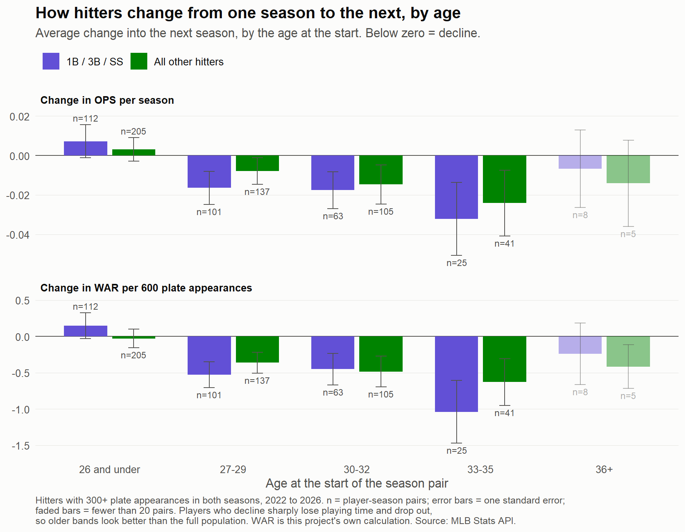

# ⚾ Seattle Mariners Trade Deadline, Post-Trade and 2027 Offseason Analyzer


A Python pipeline that pulls live 2026 MLB data — batting, pitching, standings, Statcast, and minor-league affiliate stats — from MLB's official sources and turns it into player grades, roster decisions, rest-of-season projections, and free-agent/prospect recommendations, all validated against real professional benchmarks. The data also goes into a **MySQL** database, and **R** is used for the multi-season analysis (aging curves, offense vs. pitching).

---

## 📌 Key findings

| | Finding | Headline number |
|---|---|---|
| 🏏 | **The offense explains most of the 2025-to-2026 decline.** It fell from above the league average to clearly below it, while pitching and defense stayed near average. ([details](#what-the-first-query-found)) | **~83%** of the drop |
| 📉 | **The weakest positions are third base, shortstop and first base.** ([details](#where-the-wins-are-lost-by-position)) | **~8 wins** below average combined |
| 🔁 | **Starters weaken the third time through the order, not at a pitch count.** ([details](#what-they-found)) | OPS against **.695 → .701 → .751** |
| 🤖 | **ABS challenges cost the Mariners,** mostly because hitters' challenges were overturned less often than expected. ([details](#what-they-found)) | **~¼ win** (about 2.5 runs) |
| 🔮 | **A 76-86 team gets to about 85 wins if its three star hitters recover halfway and the money is spent well.** Simulated over 10,000 seasons. ([details](#-2027-outlook-what-has-to-go-right)) | **84.9 wins**, 52% chance of 85+ |
| ✅ | **Validation caught real errors:** a simulator bug silently excluding games, and traded players' full-season stats credited to their last team. ([details](#-data-checks-what-was-wrong-and-how-it-was-fixed)) | Team runs **735 → 664** after the fix |



---

## 📑 Contents

- [How it works](#-how-it-works)
- [Quick start](#-quick-start)
- [Starting-pitcher studies and ABS](#-starting-pitcher-studies-2025-vs-2026-and-abs)
- [MySQL database and SQL queries](#-mysql-database-and-sql-queries)
- [R analysis: aging curves and offense vs pitching](#-r-analysis-aging-curves-and-offense-vs-pitching)
- [2027 outlook: what has to go right](#-2027-outlook-what-has-to-go-right)
- [Data checks: what was wrong and how it was fixed](#-data-checks-what-was-wrong-and-how-it-was-fixed)
- [Future opportunities](#-future-opportunities)
- [Data sources](#-data-sources)

---

## 🔧 How it works



**Data**: 2026 season — standings, schedules, rosters, batting, pitching, fielding and minor-league stats from the official MLB Stats API, plus Statcast from Baseball Savant. Payroll, free-agent market prices and prospect rankings come from small CSV files you maintain, and ABS challenge data from Baseball Savant leaderboard downloads (see [Data sources](#-data-sources)). WAR is the project's own calculation (see `mlb_api.py`).

### Core pipeline (`python main.py`)

- Gets live standings across all 30 MLB teams
- Gets the Mariners' full season schedule (completed games + upcoming)
- Gets batting stats and advanced Statcast metrics, league-wide
- Gets pitching stats and advanced Statcast metrics, league-wide
- Gets the Mariners' own batting, pitching, fielding, and Statcast data specifically
- Grades every Mariners player and drives roster decisions — keep, DFA, option to AAA, monitor — based on real performance, not gut feel
- Grades batters on OPS, xwOBA, and luck (xwOBA vs. actual production gap); grades pitchers on ERA, WHIP, K/9, xwOBA against, and luck
- Runs a rest-of-season simulation (live record, run differential, luck correction, real schedule difficulty, IL-return timelines) to project the final record and playoff odds
- Runs a standalone Monte Carlo simulation (thousands of simulated seasons + postseason brackets) for a higher-resolution playoff-odds estimate

### Additional tools (run separately from the core pipeline)

| Tool | Files | What it does |
|---|---|---|
| **Offseason report and weakness targets** | `offseason_report.py`, `weakness_targets.py`, `story_app.py` | Ranks the team's weakest positions and stats against the league, scores candidates by fit (position, handedness, need), and presents it as a Streamlit app, with an age-risk column for each hitter taken from the R aging curves |
| **Free-agent recommendations** | `free_agent.py`, `free_agent_stats_matcher.py`, `free_agent_recs.py`, `mlb_free_agents.py` | Loads the free-agent class (your list, or MLB's own free-agent list), matches players to league-wide stats, and scores every free agent *and* internal roster candidate against the Mariners' actual incumbent at each position, weighted by need and reliability (sample-size shrinkage) |
| **Minor-league prospect tracking** | `minor_league_stats.py`, `minor_league_shortlist.py` | Pulls the full organizational batting/pitching stats (MLB Stats API) and your top-prospect rankings CSV, filtered down to real, near-MLB-ready talent (AA/AAA, meaningful sample size, excluding anyone already on the active roster) |
| **Injury cost tracking** | `injury_cost_track.py` | Role-aware estimate of real wins lost to injury, weighted by leverage for relievers and games-missed for everyday players |
| **Payroll tracking** | `payroll.py` | Team and league-wide payroll comparisons from your payroll CSVs |
| **Platoon lineup optimizer** | `platoon_lineup_optimizer.py` | vs-LHP/vs-RHP lineup construction from real split data |
| **Starting-pitcher and ABS studies** | see [below](#-starting-pitcher-studies-2025-vs-2026-and-abs) | Pitch counts, velocity, pitch mix, whiffs, release point and ABS challenges |
| **MySQL database and SQL queries** | `load_mysql.py`, `sql/` | Loads the cached games, pitches, plate appearances and player stats into MySQL and answers questions with SQL, including whether offense or pitching explains the 2025-to-2026 drop |
| **2027 projections, roster optimizer and season simulation** | `project_2027.py`, `solution_sim_2027.py`, `sensitivity_2027.py` | Projects every player for 2027 (backtested, with an age adjustment), finds the best roster a budget can buy, and simulates 10,000 seasons for a conservative, base and optimistic case. Shown on screen 6 of the app |
| **R analysis** | `r/offense_vs_pitching.R`, `r/aging_curves.R` | Reads the MySQL database and draws charts: where the 2025-to-2026 drop came from, and how much hitters at 1B, 3B and SS decline with age. The aging results feed the app's age-risk column |

### What makes it different

- **Built on official, permitted sources.** The MLB Stats API for traditional stats, standings, rosters and minor leagues; Baseball Savant for Statcast (xwOBA, Barrel%, Whiff%, Outs Above Average). One shared module (`mlb_api.py`) handles every API call, caching, and the project's own WAR, so every table uses the same player IDs and league context.
- **Recommendations come from real statistical need, not a fixed wishlist.** Both the free-agent tool and the 2026 trade-deadline logic identify the team's actual weak spots by position and stat, league-wide, rather than starting from a hand-picked list.
- **Validated against real, independent models, not just self-consistent.** Simulator output was sanity-checked against publicly published playoff-odds projections. That process surfaced and fixed a real bug that had been silently excluding a chunk of the remaining schedule from every projection — the tool catching its own mistakes rather than just producing a number and trusting it. The same discipline (a small debug script to confirm the real data structure before trusting a source) has been used to catch and fix real bugs throughout this project.

> [!NOTE]
> **Trade-deadline tools:** `recommender.py`'s seller-based trade targets and the simulator's deadline step were built for the 2026 trade deadline and are kept for reference. For the offseason, the free-agent and internal-candidate tools are the current way to answer "how does this team improve."

---

## 🚀 Quick start

```bash
pip install -r requirements.txt
python main.py --refresh
```

The core pipeline runs in six steps:

```
STEP 1/6 -- Building data...
STEP 2/6 -- Analyzing team...
STEP 3/6 -- Grading players...
STEP 4/6 -- Generating recommendations...

[recommend] Generating recommendations...
  [targets] filtering batters to positions the team actually needs: [...]
  [targets] N teams flagged as likely sellers based on live standings
  [targets] N batter targets found
  [targets] N pitcher targets found
[recommend] Done.

STEP 5/6 -- Running rest-of-season simulation...
STEP 6/6 -- Generating Excel report...
```

Output is a formatted Excel report (Team Summary, Player Grades, Statcast, Stats to Improve, Trade Targets, Schedule, Simulation) plus an appended row in `data/history.parquet` for tracking trends over time in Power BI.

| To get | Run |
|---|---|
| A standalone, higher-resolution playoff-odds estimate | `python montecarlo.py --sims 5000` |
| Free-agent and internal roster recommendations | `python free_agent_recs.py` |
| Real, near-MLB-ready minor-league talent (excludes anyone already on the active roster) | `python minor_league_shortlist.py` |

<details>
<summary><b>Offseason workflow</b></summary>

```bash
python main.py --refresh --print-only    # refresh data and grades without writing the Excel report
python offseason_report.py               # where the team is weakest, by position and stat
python position_needs.py                 # wins lost at each position, Mariners-only playing time
python weakness_targets.py               # candidates ranked by fit to those weaknesses
python -m streamlit run story_app.py     # the same, as an app
python mlb_free_agents.py                # after the World Series: fills data/inputs/free_agents.csv
```

The free-agent list only exists after the World Series. Market prices in `data/inputs/free_agent_market.csv` are entered by hand.

</details>

---

## 🎯 Starting-pitcher studies (2025 vs 2026) and ABS

A set of small, self-contained studies built on MLB's public Stats API play-by-play and Baseball Savant's manual leaderboard downloads. They answer: *when should a Mariners starter come out, and why did some starters slip from 2025 to 2026?*

> [!IMPORTANT]
> **Data and limits.** Play-by-play comes from `statsapi.mlb.com` (one request per game, cached on disk, with a pause between requests and a descriptive user-agent). ABS leaderboards are downloaded by hand from Baseball Savant. Samples are small (17-32 starts per pitcher), numbers are raw (no park, opponent or defense adjustment), and everything below is a pattern worth watching, not proof of cause.

### What they found

- **Pitch count is not the signal.** Opponent OPS does not climb through about 100 pitches, and starters rarely go past it. The weak spots are the 6th inning and the third time through the order (OPS against .695 / .701 / .751 the first, second and third time). Innings 1 and 3 are also rough (OPS .788 and .793; the 3rd is the worst at about 5.1 runs per 9) while innings 2 and 4 are strong. That follows the lineup (the top of the order bats in innings 1 and 3), so part of the third-time-through jump may be the top of the order coming back, not tiring. Castillo is the exception: his trouble comes early (pitches 26-50, innings 3-4).
- **Velocity is not a "take him out" signal either.** Starts 1+ mph below a pitcher's own median allowed 2.91 runs per 27 batters, against 3.01 in normal starts, and 54 of 138 starts lose 1+ mph from the first to the last 25 pitches with nothing wrong (Kirby and Gilbert do it almost every start).
- **The staff barely slipped; four starters did.** Staff OPS against went from .700 to .710 and runs per 27 batters from 2.86 to 2.93, with hard contact down 3.4 points. Kirby, Woo, Castillo and Gilbert lost strikeouts (Kirby's whiff rate 26.7% → 22.4%) while Hancock and Miller, who rebuilt their pitch mix, improved.
- **Where it went wrong.** Castillo's slider lost 11 points of whiff rate (36.5% → 25.5%) and is thrown in the zone far more often (38.8% → 51.4%). Woo's 2025 BABIP (.239) was unusually low and moved to .285. Gilbert threw fewer of his best strikeout pitches while his release point drifted about 9 inches over the season. Release-point shifts happened on different dates for different pitchers, so they are not a tracking recalibration.
- **ABS.** Challenges cost the Mariners roughly a quarter of a win (about 2.5 runs). It came from hitters' challenges: they were overturned 41.7% of the time against 48.9% expected from the pitch locations (-2.7 runs, 28th of 30 teams). Catchers were about average (+0.2 runs, 11th). Individual numbers rest on very few challenges (most players have fewer than 10), and "expected" comes from Baseball Savant's own model.
- **Bullpen.** Relievers' OPS against rose from .694 before the All-Star break to .797 after (rough 90% range +.002 to +.196, so probably real but modest). It was mostly an August problem: July was the best month of the season (.614), August the worst (.896), September in between (.764). Hard contact did not rise (39.0% to 37.8%). The bullpen converted 35 of 63 save chances (55.6%, 26th of 30; league average 63.5%) with 28 blown saves (league average 23.9) and 81 holds (league 87.9). Availability mattered: Brash (four injured-list stints, last pitched June 8), Wilcox (out Aug 7 to Sep 28), Criswell (June 9 to Aug 31), Davila (from Aug 31) and Vargas (until Aug 21) all missed stretches, and the closer, Muñoz, had a 4.24 ERA (1.73 in 2025) and a short injured-list stay in late September. Of the healthy relievers, Bazardo (.679 to .988) and Ferrer (+.113) declined. This is an association, not proof that injuries caused the blown saves, and roster turnover means the two halves are not the same group of pitchers.

> [!CAUTION]
> **Caveats.** Starters are pulled when they tire (selection bias), runs include unearned runs, and several pitch-level comparisons rest on a modest number of swings. Treat each result as a lead to check with more data.

<details>
<summary><b>The scripts and how to run them</b></summary>

| Script | What it does |
|---|---|
| `pitch_count_study.py` | Opponent OPS by pitch count, inning and times through the order; fastball velocity by start. Caches every game. |
| `compare_seasons.py` | Every starter, 2025 → 2026: workload, results, velocity, innings, times through the order. |
| `pitchmix_babip.py` | Pitch mix by pitch type, and BABIP / hard-hit rate against. |
| `whiff_by_pitch.py` | Whiff, called+swinging strike, zone and chase rates per pitch type. |
| `pitchshape.py` | Spin, movement, extension, release and location per pitch type; lists pitches that lost whiffs and what changed with them. |
| `release_timeline.py` | Release point by start; dates the biggest shift and says whether it fell at a season boundary. |
| `abs_analysis.py` | ABS challenge results for Mariners hitters, catchers and teams from the Savant downloads. |
| `bullpen_split.py` | Mariners relievers' results by month and first half vs second half, with a rough range (resampling games) for the change. Reads the cache `pitch_count_study.py` builds. |
| `bullpen_context.py` | Save conversion and blown saves against the league, and which relievers were available (batters faced by half, plus their injured-list moves from the API's transactions). |

```bash
python pitch_count_study.py          # first run downloads the season (about 1-2 minutes), then it is cached
python compare_seasons.py            # 2025 vs 2026 (add --a/--b for other years)
python pitchmix_babip.py
python whiff_by_pitch.py
python pitchshape.py
python release_timeline.py
python abs_analysis.py               # needs the Savant CSVs in data/inputs
python bullpen_split.py              # run pitch_count_study.py first
python bullpen_context.py
```

`data/` is git-ignored: the scripts rebuild their cache, and Savant CSVs are downloaded by hand.

</details>

---

## 💾 MySQL database and SQL queries

The cached data can be loaded into a local MySQL database, so questions about the team can be answered with SQL instead of pandas code.

### What the first query found

Does the offense or the pitching explain the 2025-to-2026 drop? Measured per game against the rest of the league:

| | Offense vs. league | Pitching and defense vs. league |
|---|---|---|
| 2025 | +0.29 runs | +0.17 runs |
| 2026 | -0.40 runs | +0.03 runs |
| **Change** | **-0.69** | -0.14 |

- **The offense explains about 83% of the drop.** It went from above the league average to clearly below it and was below the league in five of seven months of 2026; pitching and defense stayed near average.
- **The one big pitching problem was a single month.** Runs allowed jumped to 6.26 per game in August 2026 (1.97 runs per game worse than the league), while pitching beat the league in every month before it.
- **Caveats.** The first and last months hold few games, "pitching" here means runs allowed and so includes defense, and this is one season compared with another, a pattern rather than proof.

<details>
<summary><b>Setup, tables and queries</b></summary>

```bash
pip install sqlalchemy pymysql
python load_mysql.py          # asks for your MySQL password; creates the mlb_project database
```

For the multi-season analysis, build and load the earlier seasons' player tables too:

```bash
python build_history.py                                       # player tables for 2022-2025, cached as parquet
python load_mysql.py --players-only 2022 2023 2024 2025 2026  # loads them into MySQL
```

The loader reads the files the other scripts already cache (`data/exports`, `data/cache`, the Statcast CSVs) and the season schedule, creates the tables from `sql/schema.sql`, and fills them. Re-running it replaces a season's rows instead of duplicating them. Connection settings come from the environment (`MLB_DB_HOST`, `MLB_DB_PORT`, `MLB_DB_USER`, `MLB_DB_PASSWORD`, `MLB_DB_NAME`); the password is never stored in the repo. Tested on MySQL 8 and MariaDB.

| Table | Contents |
|---|---|
| `games` | Every regular-season game: date, teams, runs, innings, whether it was played |
| `plate_appearances` | Every plate appearance against Mariners pitchers: pitcher, batter, times through the order, result |
| `pitches` | Pitch-by-pitch: type, speed, spin, movement, release point, location, call |
| `batting_players`, `pitching_players` | League-wide season stats by player, 2022 to 2026 |
| `batting_seasons` (view) | One row per hitter per season: age, position, PA, HR, OPS, WAR |
| `statcast_players` | xwOBA, Barrel%, hard-hit and whiff rates by player |

`sql/queries.sql` holds the analysis queries: runs scored and allowed by month against the league, starter workload and fastball velocity, OPS against by time through the order, whiff rate by pitch type, hitters' expected stats, and the Mariners' league ranks.

</details>

---

## 📈 R analysis: aging curves and offense vs pitching

Two R scripts read the MySQL database (DBI and RMariaDB), do the calculation in R and draw the chart with ggplot2. The MySQL password is asked for when the script runs and is never stored in the repo.


```r
# in RStudio, with the working directory set to the project folder
source("r/offense_vs_pitching.R")   # Mariners vs the league by month, 2025 vs 2026
source("r/aging_curves.R")          # how hitters change from one season to the next, by age
```

Packages: `install.packages(c("DBI", "RMariaDB", "dplyr", "ggplot2", "rstudioapi"))`.

The offense-vs-pitching chart (shown under [Key findings](#-key-findings)) draws the SQL result month by month: the offense moved much more than the pitching.

### Aging curves for 1B, 3B and SS

How much does a hitter change from one season to the next, by age? The script takes every hitter with 300+ plate appearances in two consecutive seasons (802 player-season pairs, 2022 to 2026), measures the change in OPS and in WAR per 600 plate appearances, and averages it by the age at the start of the pair. Players with more plate appearances count more. The Mariners' positions of need (1B, 3B, SS) are compared with all other hitters.



- **Hitters decline steadily from the late 20s.** At ages 27 to 32 a hitter typically loses about half a win per 600 plate appearances each season (1B/3B/SS: -0.53 at 27-29 and -0.45 at 30-32; other hitters: -0.36 and -0.48).
- **Infielders may age a little harder, but the data cannot show it yet.** At 33-35 they lost 1.04 WAR per 600 PA against 0.63 for other hitters (25 and 41 players), but the error bars overlap. With five seasons of data this is a hint, not a finding.
- **Ages 36 and up are too thin to use** (8 infielders, 5 other hitters); the chart fades any band under 20 pairs.
- **Caveat.** Players who decline sharply lose playing time and drop out of the sample, so the real decline is probably steeper than shown. WAR is this project's own calculation.

> [!TIP]
> The script also saves `data/exports/aging_by_age_band.csv`. `age_risk.py` reads it and adds an **age risk** column to the free-agent screens of the app: the typical decline for a hitter of that age and position group, labelled Low, Moderate or High (or "Too few to say" for thin bands). It is an average for players like him, not a forecast for one player, and it covers hitters only.

---

## 🔮 2027 outlook: what has to go right

The Mariners went 76-86 in 2026 after 90-72 in 2025. This part of the project asks: **what would the 2027 roster need to look like to get back to the playoffs, and how likely is that?** It projects every player, finds the best roster a given budget can buy, and simulates 10,000 seasons for each of three scenarios.

### Result

*Run: `python solution_sim_2027.py --exclude "Tarik Skubal" --exclude "Drew Rasmussen" --lock "Left Fielders=none"`. Skubal and Rasmussen are excluded because the first is priced beyond what is realistic and the second is unlikely to be traded. The no-new-money starting point is **75.5 wins**.*

| Scenario | What has to go right | New money | Expected wins | 80% range | Chance of 85+ | Chance of 90+ |
|---|---|---|---|---|---|---|
| **Conservative** | Projections only; free-agent plan, no trades | $50M | **79.4** | 71-88 | 28% | ~13% |
| **Base** | Raleigh, Naylor and Julio Rodríguez recover halfway; two trade targets | $94M | **84.9** | 77-93 | 52% | ~31% |
| **Optimistic** | All three fully recover; four trade targets | $145M | **90.6** | 83-98 | 76% | ~55% |

- **Base is roughly a coin flip for 85 wins**, with no help from the top free-agent starter or from a trade the other team has said it will not make.
- **Where the wins come from (Base):** about +1.8 from the three hitters recovering, +6.4 from free agents, +1.2 from trades.
- **The plan (Base):** sign Seiya Suzuki (RF), Jason Adam (RHP), Adrian Morejon (LHP) and Michael King (SP); trade for Zach Neto (SS) and Joe Ryan (SP).
- **Randy Arozarena is not re-signed in Base.** At his price the money does more elsewhere. He is re-signed in the Optimistic scenario, where the budget is larger.
- **Kade Anderson** (the #3 pick in 2025, 3.79 ERA over 35.2 MLB innings) is treated as a free, under-contract rotation candidate with a 3.92 ERA, the Baseball Reference 2027 projection. The model's five-man rotation does not include George Kirby, which makes Kirby a surplus starter and a trade chip. Trading him changes Base by 0.1 wins, but what he would bring back is not modelled.

### What drives the result (sensitivity)

`sensitivity_2027.py` changes one assumption at a time from the Base plan (84.8 wins in that run):

| Change | Effect on Base |
|---|---|
| Hitters recover fully instead of halfway | +4.5 wins |
| Starters also recover fully (Woo, Gilbert) | +2.4 wins |
| Budget cut from $100M to $60M | -2.0 wins |
| No trades allowed | -1.8 wins |
| Free-agent prices 25% higher / lower | about -1 / +1 win |
| Defense weighted fully instead of half (`--def-keep 1.0`) | -0.6 wins; same plan |

**The biggest bet is whether the three hitters bounce back.** Prices, defense and the budget matter far less.

### How it works

1. **Projections** (`project_2027.py`): a three-year, recency-weighted (3/2/1) blend of each player's own record, pulled toward the league average in proportion to how little he has played (the same idea as the Phillies strikeout-rate project). Hitters use OPS, pitchers use ERA. Hitters also get an **age adjustment** from the R aging curves, with the strength chosen by backtest.
2. **Roster optimizer** (`solution_sim_2027.py`): builds every 2027 spot (9 lineup spots, 2 setup-reliever spots, 5 rotation spots) and finds the best signings within a budget using a knapsack search, with an optional limit on the number of trades. Players under contract are free; free-agent prices are the larger of last contract and about $8M per projected win.
3. **Season simulation:** 10,000 simulated seasons with random talent error for each player (the same luck in every scenario) and game-by-game luck. Runs convert to wins with a Pythagorean formula calibrated to Seattle's official 2026 totals (664 scored, 722 allowed).
4. **Scenarios:** a "rebound" setting moves Raleigh, Naylor and Rodríguez a fraction of the way from their 2026 OPS back to their 2025 OPS (0, 0.5, 1.0). Trade targets come from `data/inputs/trade_targets.csv` and are charged in salary only.
5. **The app:** screen 6 of `story_app.py` shows the scenarios, the problem-to-solution table for each, and where the wins come from.

### How accurate are the projections? (backtest on 2025 and 2026)

| Error vs. what happened (lower is better) | Projection | League-average guess | "Same as last year" |
|---|---|---|---|
| Hitters (OPS) | **0.065** | 0.073 | 0.080 |
| Pitchers (ERA) | **0.97** | 1.02 | 1.26 |

- For hitters the projection beats both simple guesses, and the gap is biggest for players with little playing time last year (0.076 vs 0.105 for "same as last year" under 250 PA).
- The age adjustment cut hitter error a further 1.4% (0.0651 to 0.0642). The aging curves were built from the same seasons, so this is a slightly friendly test.
- **Pitcher ERA is hard to predict.** The projection is only modestly better than guessing the league average, so the pitching side carries more uncertainty than the hitting side.

### Limits

- **The result rests on the three-hitter rebound.** If Raleigh, Naylor and Rodríguez do not recover, Base falls toward the Conservative result.
- **Trades cost salary only.** A real trade also costs prospects, so trade gains are an upper bound. What a traded player brings back (such as for Kirby) is not modelled.
- **Prices are anchors, not predicted bids.** Some players (for example Suzuki) end up priced above their likely market.
- **Defense is one noisy season** of Statcast fielding runs, half kept. The rebound moves hitting only.
- **Starters are valued on ERA alone,** with no injury risk, and young pitchers such as Anderson rest on a small sample.
- **Not modelled:** payroll limits (payroll files are blank), left-handed vs right-handed balance, and prospect value.

<details>
<summary><b>Run order and options</b></summary>

```bash
python offseason_report.py        # diagnosis, free-agent scoring, exports
python project_2027.py            # 2027 projections, backtest and age adjustment
python solution_sim_2027.py --exclude "Tarik Skubal" --exclude "Drew Rasmussen" --lock "Left Fielders=none"
python sensitivity_2027.py        # one-at-a-time changes from the Base plan
python -m streamlit run story_app.py   # screen 6 = the outlook
```

| Option | What it does |
|---|---|
| `--exclude "Name"` | Rules a player out (repeat for more) |
| `--lock "Left Fielders=none"` | Unlocks a spot that is otherwise held for a named player |
| `--trade-away "George Kirby=9.8"` | Removes a player and frees his salary |
| `--sp-rebound 1.0` | Lets starters recover toward their 2025 ERA |
| `--def-keep 1.0` | Counts fielding runs fully instead of half |
| `--scenario-budget Base=120` | Changes a scenario's budget in $M |

The app shows whichever run was made last, so finish with the headline command above. Rotation candidates under contract, such as Anderson, can be given a projection by hand in `data/inputs/prospect_overrides.csv` (`Name,Proj_ERA`).

</details>

---

## ✅ Data checks: what was wrong and how it was fixed

Checking the team tables against the game-level data in MySQL turned up several errors. They are fixed, and are written down here because they change how the numbers should be read.

> [!WARNING]
> **Team totals were inflated by traded players.** The player-level API returns a traded player's whole-season totals under his *last* team. Summing player rows therefore gave the Mariners **6,657 plate appearances and 735 runs**, against the official **6,089 and 664** (the games table in MySQL agreed with the official figures).

Two fixes in `mlb_api.py`:

- Team counting stats (runs, hits, walks, strikeouts and so on) now come from the API's official team totals (`fetch_team_stats`).
- Team and position WAR and fielding runs are split across the teams a player played for, in proportion to his playing time with each (`split_by_team`): plate appearances for hitters, outs recorded for pitchers, innings at the position for fielders.

| Problem | Fix |
|---|---|
| **Fielding was judged on the wrong scale.** The diagnosis treated 5 runs as a typical team-to-team spread. The real spread is about 23 runs, so Seattle's -50 was scored as an extreme outlier (severity 10.6) when it is roughly two spreads below average (severity 2.2). | The threshold in `team_diagnosis.py` is now 23. |
| **The diagnosis used whole-season player rows.** | `team_diagnosis.py` now reads the Mariners' batting, rotation, bullpen and fielding lines from the corrected team-level tables. |
| **Year-over-year fielding overwrote values.** `year_over_year_decomposition.py` overwrote a player's value when he appeared at more than one position. | It now adds them up. The fielding change reads about -19 to -53 runs, and the ledger in `offseason_report.py` uses the same diagnosed total. |

### What the corrected data says about 2026

| Area | Result |
|---|---|
| Runs per game | 4.10, 28th of 30 |
| Offense (batting WAR from hitters) | 11.7, 29th |
| Weakest positions by WAR | 3B (-0.8, 30th), SS (-0.1, 29th), 1B (-0.2, 28th) |
| Pitching | ERA 4.20 (19th), FIP 3.99, pitcher WAR 20.0 (8th) |
| Team fielding | -50 runs, 30th |

The earlier reading that pitching was the problem does not hold up: the offense was bad, and fielding fell sharply. How much of the fielding drop is real defence and how much is a changed roster is not settled, so that remains a hypothesis rather than a finding.

### Where the wins are lost, by position

`position_needs.py` answers "which positions cost the Mariners the most wins?" using only what each player did while he was a Mariner. A traded player's season is split by playing time, so his time with other teams does not count for Seattle. A hitter's WAR and plate appearances are shared across the positions he played in proportion to games at each, with games not in the field counted as DH. For each position the Mariners' WAR is compared with the league average, and the gap is in wins.

| Position | Mariners WAR | League average | Wins below average |
|---|---|---|---|
| 🔴 **Third base** | -0.7 | 2.2 | **3.0** |
| 🔴 **Shortstop** | -0.1 | 2.7 | **2.8** |
| 🔴 **First base** | -0.2 | 2.3 | **2.5** |
| 🟡 Right field | 0.6 | 1.6 | 1.0 |
| 🟡 Second base | 1.3 | 2.1 | 0.8 |
| 🟡 Center field | 2.0 | 2.7 | 0.8 |
| 🟡 Designated hitter | 2.2 | 2.8 | 0.6 |
| 🟢 Catcher | 2.2 | 2.1 | -0.1 |
| 🟢 Relievers | 2.8 | 2.7 | -0.1 |
| 🟢 Left field | 4.5 | 1.7 | -2.8 |
| 🟢 Starting pitchers | 17.2 | 11.3 | -5.9 |

🔴 Biggest need (1.5+ wins below average) · 🟡 Below average (more than 0.25) · 🟢 At or above average

The Mariners' starter at each position is the player with the most plate appearances there (at least 50 with the team), so a part-timer is no longer picked as the incumbent. The same starters feed the free-agent comparison and the depth chart in the app.

The weakest positions are third base, shortstop and first base. The rotation is far ahead of the league, so pitching is not where the wins went. Starters reflect 2026 playing time, not a 2027 plan, so an injured player can still be listed.

<details>
<summary><b>Known limits</b></summary>

- The fielding-first section of the report still picks its own "current" player at each position (for example Weston Wilson at third base), separate from the starters above.
- Fielding is measured with one system, Statcast Outs Above Average, and other systems (Total Zone, Defensive Runs Saved) can rate individual players differently. The team-level finding (-50, 30th) is a Statcast-based reading, not a consensus across metrics.
- Starters come from 2026 plate appearances at a position. They do not account for injuries or who is expected to play in 2027.
- Player-level Mariners tables are still whole-season rows for traded players.
- The free-agent pool is small until after the World Series.
- One Baseball Savant catcher-framing file produces a parsing warning, which has not been fixed.

</details>

---

## 🔭 Future opportunities

- [ ] Fold minor-league shortlist candidates into the free-agent recommendation scoring, so "sign a free agent," "promote a prospect," and "play the bench guy we already have" are one ranked list instead of three separate tools
- [ ] Compare against previous seasons (multi-year player and team trend analysis; the starting-pitcher studies already do this for pitching)
- [x] 2027 projections, roster optimizer and season simulation (backtested; sensitivity checked)
- [ ] Model prospect value and what a traded player brings back, so trade gains are not an upper bound
- [ ] Check the lineup's left/right balance and the payroll limit once 2027 contract data is available
- [ ] Backtest the rest-of-season projection system against the actual final outcome once the season ends
- [ ] Extend payroll data (`payroll.py`) into genuine value-per-dollar analysis
- [ ] Model in R: replacement level by position, and a back-test of the free-agent fit model against past offseasons
- [x] Aging curves in R
- [ ] Load earlier seasons' Statcast tables into MySQL (player batting and pitching stats for 2022 to 2026 are already there)
- [ ] Update the trade-deadline tools for the 2027 deadline

---

## 📚 Data sources

| What | Source | File |
|---|---|---|
| Standings, schedules, rosters, player/team stats, minor leagues, platoon splits | [MLB Stats API](https://statsapi.mlb.com) via `MLB-StatsAPI` | `mlb_api.py` and the modules built on it |
| Pitch-by-pitch play-by-play (pitch counts, velocity, spin, release, results) | [MLB Stats API](https://statsapi.mlb.com), cached per game | `pitch_count_study.py` and the studies built on it |
| Statcast (xwOBA, Barrel%, Whiff%), fielding runs (Outs Above Average) | [Baseball Savant](https://baseballsavant.mlb.com) | `statcast_scraper.py`, `mlb_api.py`, `team_half_splits.py` |
| Free agent class | A hand-maintained CSV, or MLB's free-agent list | `data/inputs/free_agents.csv` |
| Free agent prices (last salary, contract type) | A hand-maintained CSV | `data/inputs/free_agent_market.csv` |
| Payroll | A hand-maintained CSV | `data/inputs/payroll_players.csv`, `data/inputs/payroll_league.csv` |
| Top prospect rankings | A hand-maintained CSV | `data/inputs/top_prospects.csv` |
| Trade targets (name, position, 2027 salary) | A hand-maintained CSV; salaries from public sources (MLB Trade Rumors, Spotrac, FanGraphs RosterResource), arbitration figures are estimates | `data/inputs/trade_targets.csv` |
| Optional hand-set projections for players with little history | A hand-maintained CSV (Kade Anderson: Baseball Reference 2027 projection) | `data/inputs/prospect_overrides.csv` |
| ABS challenges | Baseball Savant ABS leaderboard, "Download CSV" by hand (batter, catcher, batting-team and fielding-team views) | `data/inputs/abs*.csv`, read by `abs_analysis.py` |

Blank CSV templates with the right column headers are created in `data/inputs/` the first time each feature runs; anything left empty is skipped gracefully. Data is not included in this repository (`data/` is git-ignored) — run `python main.py --refresh` to build it locally.

<details>
<summary><b>About WAR</b></summary>

WAR here is this project's own implementation of the standard public WAR framework (mlb_api.py), built from MLB Stats API and Statcast inputs, so numbers will be close to but not identical to other published WAR figures:

- **Batters:** (batting runs from wOBA + baserunning runs + Statcast fielding runs + positional adjustment + replacement runs) ÷ runs per win
- **Pitchers:** runs allowed per 9 vs. a league baseline adjusted for role (starter/reliever) and the team's defense, compared to a replacement-level pitcher; relievers are scaled by an estimated leverage

**Fielding column names.** `Rtot` and `Rdrs` in the code are older column names. In this project both hold Statcast fielding runs (Outs Above Average, plus framing runs for catchers).

</details>

---

**Tools and resources.** This project was built in Python, MySQL and R. Claude (Anthropic, https://claude.ai) was used as a collaborative tool for designing the modelling approach, writing and debugging code, and drafting this documentation; the results were checked by running the code on real data and comparing against independent sources.

<sub>MLB data © MLB Advanced Media, L.P. Use is personal and non-commercial, per MLB's [copyright notice](http://gdx.mlb.com/components/copyright.txt).</sub>